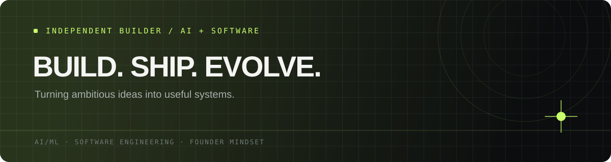

 

 

&nbsp;

---

## The short version

I'm **Pratheek H J** — a CSE student specialising in AI & ML at PES University, Bengaluru.

I’m drawn to the overlap between **intelligent systems, thoughtful engineering, and products people actually want to use.** I like understanding how things work, pulling apart difficult problems, and turning ideas into something real.

Not here to collect buzzwords. Here to build the skill to build things that matter.

- **Exploring:** AI/ML, software engineering, algorithms, and app development
- **Building:** practical projects and early experiments
- **Thinking about:** developer tools, privacy-first products, and entrepreneurship
- **Long game:** become an excellent engineer, then use that ability to build ambitious products

## The toolkit

I care more about understanding a tool deeply than listing fifty tools I barely know.

## Things I've put into motion

<strong>01 / Aurora — Privacy-first search exploration</strong>

A project exploring a more privacy-conscious search experience. It’s early-stage, and I’m treating it as a chance to think clearly about the problem, architecture, and what a genuinely useful first version should do.

**[Explore Aurora →](https://github.com/HJ-pratheek28/Aurora----The-Private-search-X)**

<strong>02 / The next build</strong>

I’m working toward projects that go beyond a polished demo: a clear user problem, a sensible technical design, honest evaluation, and documentation that lets someone else run the thing.

This section will earn its next entry when there’s real work to show.

## How I like to work

| Principle | What it means |
|:--|:--|
| **Substance over theatre** | Working software beats impressive-sounding claims. |
| **Fundamentals first** | Understand the system before reaching for another framework. |
| **Ship, then sharpen** | Get a useful version working; improve it with evidence. |
| **Stay curious** | The best ideas often come from connecting different fields. |

## The signal, not the noise

### Good taste. Strong fundamentals. Useful things.

*Build quietly. Let the work introduce you.*

 

[**See what I'm building →**](https://github.com/HJ-pratheek28?tab=repositories)

---

Currently learning in public. Always interested in thoughtful builders, challenging problems, and ideas worth making real.
